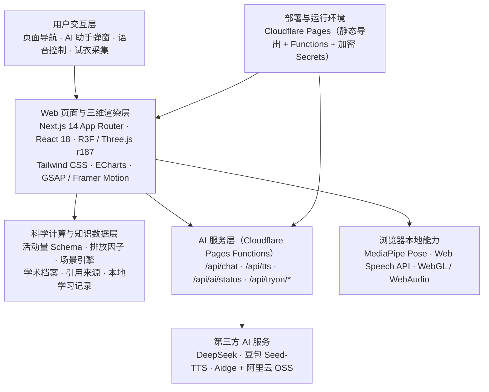

# CarbonTwin——碳排放与低碳生活交互平台

> **See the Unseen——看见看不见的碳。**
>
> 正式网址：<https://carbontwin.pages.dev/>
> 参赛方向：传智杯 AI Web

---

## 01 项目基本信息

| 项目 | 内容 |
|---|---|
| 项目名称 | CarbonTwin——碳排放与低碳生活交互平台 |
| 项目理念 | See the Unseen——看见看不见的碳 |
| 正式网址 | https://carbontwin.pages.dev/ |
| 参赛方向 | 传智杯 AI Web |
| 团队名称 | 吮月风雅（团队编号 40203，C组） |
| 所属院校 | 广州华立科技职业学院（云浮校区） |
| 指导老师 | 吴贤老师 |
| 代码仓库 | https://github.com/quanzhilong-xxim/carbon-twin-final （GitHub Public） |
| 技术形态 | Next.js 14 App Router + React Three Fiber 三维 + Cloudflare Pages 静态部署 + Pages Functions AI 服务 |
| 运行方式 | 纯浏览器访问，无需注册登录；学习记录只保存在当前浏览器本地 |
| 当前状态 | 正式网站已上线并可体验；三维、学术档案、行为沙盘、AI 助手、AI 语音、AI 虚拟试衣均已接入 |

> 仓库与本文档的版本对应关系、以及仓库尚需补齐的内容，已在 `桌面\托管平台\仓库访问与版本说明.md` 中如实说明。本文档中的技术版本、功能、数据均来自真实工程源码与线上网站，未虚构不存在的模块。

---

## 02 项目背景

我们这一代人几乎都知道“碳排放很重要”，却很少有人能说清楚：**它和我的生活到底有什么关系？**

一盏灯开了一整夜，一次十几公里的通勤，一杯每天都要喝的咖啡，一件穿三年还是穿一季的衣服——这些日常选择背后，是电力的生产、燃料的燃烧、原料的种植与加工、物流与废弃处置，是一条条看不见的资源流动。碳排放难理解，不是因为它不重要，而是因为它太抽象：它没有颜色、没有形状，也不会在生活里发出声音。

与此同时，气候教育常常面临两个困境：一边是 IPCC、GHG Protocol 这类严谨的科学文献，普通年轻人很难读懂；另一边是口号式的“低碳生活”，容易停留在“关灯、少开车”的简单重复，无法解释“为什么这样算”“我的选择到底改变了什么”。

CarbonTwin 想做的，是在科学证据与日常生活之间搭一座桥。我们不希望低碳教育只停留在口号，而是希望每一个年轻人都能理解自己的选择为什么重要——**先看见，再理解，然后才有可能改变。**

---

## 03 项目介绍

CarbonTwin 把 **三维交互、人工智能、碳排放科学计算、学术证据、多身份学习与日常生活决策** 整合进同一个 Web 平台：

- 用一座可以走进去的三维城市，让抽象的碳排放拥有空间形态；
- 用三种城市身份，让同一条城市数据随视角变化被重新理解；
- 用可追溯的学术档案，让每一个判断都能找到来源与边界；
- 用行为沙盘，让“改变一个习惯”变成可以被比较的 A/B 情景；
- 用 AI 助手与 AI 语音，降低专业知识的理解门槛；
- 用 AI 虚拟试衣，把“衣服的碳成本”从概念带到镜头前的真实选择。

我们每天打开的一盏灯、乘坐的一次交通工具、喝的一杯咖啡、购买的一件衣服，背后都存在容易被忽略的资源消耗与碳排放。CarbonTwin 希望通过三维场景、人工智能和科学数据，让这些原本抽象的知识成为**能够看见、能够理解、能够探索**的日常体验。

---

## 04 核心功能

### 4.1 探索：看见一座会生长的城市

- **粒子城市生长**：从数据粒子 → 树木 → 场地 → 建筑 → 城市被点亮，用一段可观看的空间叙事解释“城市从哪里来”。
- **六种城市探索场景**：文化之城、滨水活力、创新湾区、生态山谷、未来枢纽、共生之城。每个场景对应一个值得追问的城市问题（公共记忆、水岸生活、科研与公共空间、生态优先、低碳换乘、人与自然）。
- **城市建筑与空间互动**：可环绕观察、点击建筑与室内空间，理解交通、建筑、能源与日常选择之间的联系。
- **城市设计线索**：同一座城市不是唯一答案；不同密度、交通与生态选择，对应不同的资源流动方式。

> 说明：城市与人物为原创三维资产与艺术化研究场景，是**空间示意与教学表达**，不是对真实城市的实测数字孪生。

### 4.2 身份视角：同一座城市，三种需要被看见的关系

| 身份 | 角色 | 视角 | 核心问题 |
|---|---|---|---|
| 学生 | 星遥 · THE EXPLORER | 学习现场 / 日常选择 | 从一段通勤开始，把好奇变成可以追问的问题 |
| 企业主 | 产业领航者 · THE BUILDER | 决策现场 / 价值链 | 每一次采购和设计，如何影响长期责任与增长 |
| 城市管理者 | 智衡 · THE STEWARD | 治理现场 / 公共生活 | 在有限土地与资源之间，如何让更多人抵达 |

- 每位角色都有独立的三维模型、多视角展示与互动动作（挥手致意、轻转身、自然休息、观察、微笑等）。
- 不同身份对应不同的引导问题与学习路径；身份选择保存在当前浏览器，切换后整站叙事随之改变。
- 角色设计保留 Blender Foundation 的 Rain / Snow 基础拓扑署名（CC BY 4.0），服装、道具与动作由本项目原创制作或改编，具体见 `代码规范\第三方资源及许可证说明.md`。

### 4.3 学术档案：让每一个判断都有据可循

- **Scope 1 / Scope 2 / Scope 3 核算边界**：用“同一座工厂、三种排放边界”的场景，解释分类取决于“谁拥有或控制排放源”，而不是把个人行为简单贴上三种标签。
- **排放边界与公式**：明确 `E = Σ(AD × EF)`（活动量 × 排放因子），先定义组织边界，再讨论排放。
- **服装生命周期**：从纤维、织物、染整、成衣、运输、使用到废弃，理解一件衣服的旅程。
- **纤维与织物科普**：棉、涤纶、羊毛等材料的结构与教学对比，明确其为示意模型而非显微观测或实测成分。
- **科学证据与引用**：条目带来源机构、链接、定位与局限说明，支持搜索、收藏、引用详情与关联学习。
- **可追溯的学习方式**：所有引用均保留出处；本站中文翻译与解释属于编辑工作，不冒充原始文献，也不代表机构合作或背书。

### 4.4 行为沙盘：改变一个选择，比较一组真实计算的情景

行为沙盘以十章叙事推进，每一章都从一个具体的日常场景出发：

**樱花之约 → 日常选择 → 四季生态舱 → 城市之光 → 咖啡时光 → 生态伙伴 → 两种生活 → 牧场来信 → 数据回响 → 城市余韵**

- 在“日常选择”中，拖动用电、汽油、牛肉等活动量，观察年度排放、2050 累计与来源结构如何变化；
- 在“两种生活”中，对比住宅与办公空间，并切换“相同面积 / 相同人数”口径，理解**比较必须先统一尺度**；
- 在“咖啡时光”中，只核算咖啡馆运行购电的边界，并明确奶、咖啡豆、包装、冷媒与物流需要另外的数据；
- 在“生态伙伴”中，用角色回应对日常选择做出可感知的反馈，但明确“陪伴不会改变核算结果”；
- 支持报告导出（PDF），页面上所有数字均标注为教学估算及核算边界。

### 4.5 其他已上线的真实页面

- **建筑与城市 `/city-studies`**：建筑立面、室内空间与能源关系的空间研究。
- **光之塔 `/citylight` 及研究页**：城市灯光装置与空间设计研究。
- **服装与 AI 试衣 `/workspace`**：服装三维展示、摄像头采集、MediaPipe 姿态检测与 Aidge 真实 AI 虚拟试衣。
- **豆包语音试听 `/tts-audition`**：音色与朗读体验页。
- **搜索 `/search`**：站内知识搜索（比赛静态版中部分搜索能力降级说明，不影响档案浏览）。

---

## 05 AI 核心技术（传智杯 AI Web 重点）

CarbonTwin 的 AI 不是挂一个聊天框，而是分别嵌入“理解、表达、试穿”三个真实场景。我们严格区分四类东西：**网站运行时 AI 能力、开发阶段 AI 辅助能力、普通三维渲染、确定性科学计算**。

### 5.1 DeepSeek 大语言模型：让科学知识可以被追问

- **运行位置**：服务端 Cloudflare Pages Function `functions/api/chat.js`，浏览器只与本站 `/api/chat` 通信。
- **模型**：`deepseek-chat`（可通过 `DEEPSEEK_MODEL` 环境变量切换；实测 `deepseek-flash` 返回内容为空，故未采用）。
- **能力**：
  - 碳知识问答与 AI 知识教练，围绕站内核算规则、学术档案与当前页面内容回答；
  - 多轮上下文：能记住本次对话情景，并复算“用电 + 汽油 + 牛肉”的年度排放；
  - 页面理解：请求会携带当前路径、标题与可见文本，AI 能针对用户正在看的页面作答；
  - 回答附带来源与边界说明，遇到证据不足时提示“待核验”，不伪造引用。
- **安全与成本控制**：密钥仅存于 Cloudflare 加密 Secrets；动作输出被白名单约束为 `{"type":"NONE"}`，AI 不具备修改网站、数据库或用户资料的能力；请求体上限 120 KB，单次超时 50 秒，每 IP 约 12 次/分钟限流（单实例内存态，非全站分布式配额）。
- **为什么用它**：碳知识的前置概念多、术语密集，大模型的价值不是“替用户算”，而是把“数据 → 理解 → 行动”之间缺失的解释补上，并允许用户用自己的话追问。

### 5.2 豆包 Seed-TTS 2.0：让 AI 的回答被听见

- **运行位置**：服务端 Function `functions/api/tts.js`；浏览器播放返回的 WAV 音频。
- **模型与音色**：`seed-tts-2.0`，默认音色 `zh_female_vv_uranus_bigtts`（Vivi 2.0），备选小何 2.0。
- **实际能力**：AI 文字回答的自动朗读、暂停 / 停止 / 重播 / 静音 / 音量控制；真实合成返回 `audio/wav`，服务端校验音频字节 > 0，空音频不会被伪装成成功。
- **边界**：仅当用户主动勾选“回答后自动朗读”或点击“朗读回复”时才调用，避免无意义计费；文本上限 2500 字，每 IP 约 8 次/分钟、并发 ≤2、单实例每小时 30000 字符保护。
- **为什么用它**：阅读障碍、移动场景和低龄学习者都更需要“听”；语音不是装饰，而是降低理解门槛的第二条通道。

### 5.3 MediaPipe 人体姿态识别：在虚拟试衣前先“看懂你”

- **运行位置**：浏览器本地运行 `@mediapipe/tasks-vision` 的 Pose Landmarker，模型文件本地加载。
- **实际流程**：摄像头 `getUserMedia` → 人体关键点检测 → 判断全身构图是否合格 → 10 秒采集窗口 → 用户勾选同意 → 才进入生成。
- **边界**：画面不离开浏览器；不自动重试、不批量采集；未做真人手机真实光线/构图验收（历史验收使用 Playwright 假摄像头）。

### 5.4 Aidge AI 虚拟试衣：把衣服的碳成本带到镜头前

- **平台**：阿里云 Aidge（虚拟试穿），服务端 Function `functions/api/tryon/generate.js`。
- **实际流程**：用户照片经阿里云 OSS 私有桶临时上传（15 分钟预签名，生成后尽力删除，另设 1 天生命周期兜底）→ 服务端完成 ACS3-HMAC-SHA256 签名调用 Aidge → 返回生成图 URL。七件服装已配置：黑色 T 恤、白色长袖、黄色夹克、黑色运动裤、藏青短裤、米白针织衫、浅蓝牛仔裤。
- **真实状态**：生产端到端已跑通，Aidge 免费额度 30 张 / 90 天，验收时剩余 22 张，开启“用完即停”，额度耗尽时直接报错，不伪造结果。
- **边界**：生成耗时约 80–114 秒；免费额度有限，请不要反复提交；未使用物理真人摄像头做最终验收。

### 5.5 浏览器语音识别（ASR）

- 使用浏览器 Web Speech API（`lib/hooks/useSpeechRecognition.ts`），不配置云端 ASR 凭证，不自动录音；真机麦克风权限与识别效果需本人最终确认。

### 5.6 开发阶段的 AI 辅助（明确区分，不冒充产品功能）

- 开发过程中使用了 AI 编程助手辅助代码审查、文档整理与 Blender 脚本编写；AI 只作为**开发工具**，最终代码、设计与资产取舍由开发者审核确认。
- 三维模型的制作使用 Blender 建模与脚本化生成，不是由 AI 在产品运行时实时生成。
- 网站运行时的“AI 能力”仅指第 5.1–5.5 节列出的真实服务；**固定排放公式、WebGL 粒子动画、预设人物动作都不属于 AI**，我们在文档与页面上都不把它们宣传为实时 AI。

---

## 06 技术架构

### 6.1 架构总览



### 6.2 关键版本（来自真实 `package.json`）

| 依赖 | 版本 |
|---|---|
| Next.js | 14.2.35（App Router） |
| React / React DOM | 18.3.1 |
| TypeScript | 5.x |
| three | 0.187.0 |
| @react-three/fiber | 8.18.0 |
| @react-three/drei | 9.122.0 |
| @react-three/rapier | 1.5.0 |
| @react-three/postprocessing | 2.19.1 |
| @mediapipe/tasks-vision | 1.2.3 |
| ai（Vercel AI SDK） | 7.x |
| zustand | 5.0.16 |
| tailwindcss | 3.4.17 |
| echarts | 6.1.0 |
| gsap / framer-motion | 3.15.0 / 14.9.0 |
| @playwright/test | 1.64.1（测试） |
| 部署平台 | Cloudflare Pages（静态导出 18 页 + Pages Functions） |

> 完整依赖与锁定版本见 `环境配置\package.json` 与 `package-lock.json`。

### 6.3 AI 接口在客户端还是服务端

- **多轮**：用户输入 → 浏览器 `/api/chat` → Cloudflare Pages Function → DeepSeek → SSE 流回浏览器。**密钥只在服务端**，前端 bundle 中不出现任何密钥。
- 语音：`/api/tts` 在 Function 内完成鉴权、限流、长度校验与合成，返回音频流。
- 试衣：`/api/tryon/generate` 在 Function 内签名并调用 Aidge；AccessKey 与 OSS 配置存放在 Cloudflare 加密 Secrets。
- **全工程唯一 `NEXT_PUBLIC_` 变量**是 `NEXT_PUBLIC_CT_CHARACTER_PREVIEW_REVISION`（非敏感的角色资产版本号）。
- 客户端 bundle 与发布目录做过密钥格式扫描，`sk-`、AccessKey、私钥、密钥赋值均 0 命中。

### 6.4 设计与工程结构

- 页面在 `app/`（App Router），可复用 UI 在 `components/`，三维场景在 `components/3d/`；
- 业务逻辑与视觉渲染分离：排放计算在 `lib/emissions.ts`，空间能耗在 `lib/experience/spaces.ts`，场景组织在 `components/simulator/`；
- 状态管理统一使用 zustand store，持久化用 localforage；
- 服务端安全逻辑（限流、脱敏、校验）在 `lib/server/` 与 `functions/_lib/`。

---

## 07 科学计算依据

### 7.1 核算公式

```
年排放量 = Σ (活动量 AD × 排放因子 EF)
         = 月用电量 × 12 × 电力因子
         + 月汽油量 × 12 × 汽油因子
         + 周牛肉量 × 52 × 牛肉因子
```

- **活动量**：用户输入的电（kWh/月）、汽油（L/月）、牛肉（kg/周）。
- **时间单位**：统一换算为年；累计值计算到 2050 年，并明确“固定习惯情景”，不是预测。
- **排放因子版本**：`CT-2026-11-MEE2023-0.5306-EPA2.3-EWG2011-27`（因子带版本号，避免被误认为通用现行值）。

| 因子 | 数值 | 来源 | 边界 |
|---|---|---|---|
| 电力 | 0.5306 kg CO₂ / kWh | 生态环境部、国家统计局：2023 年全国电力平均 CO₂ 因子（公告 2025 年第 47 号） | 中国全国平均、2023 数据、地点法购电间接 CO₂；非实时电网、市场法或完整生命周期 |
| 汽油 | 2.3 kg CO₂ / L | 美国 EPA：汽油每美制加仑约 8,887 g CO₂，取整教学值 | 仅燃烧 CO₂；不含燃料上游与车辆制造 |
| 牛肉 | 27 kg CO₂e / kg | EWG Meat Eaters Guide（2011）生命周期教学情景 | 特定研究的生命周期 CO₂e；不能代表每种牛肉或产地 |

### 7.2 二氧化碳与二氧化碳当量的区别

- **CO₂**：只统计二氧化碳一种气体（如电力、汽油燃烧）。
- **CO₂e（二氧化碳当量）**：把甲烷、氧化亚氮等温室气体按 100 年全球增温潜势折算为 CO₂ 当量（如牛肉生命周期）。
- 页面上会分别标注，不把两者混为一谈，也不把教学估算包装成实测数据。

### 7.3 核算范围与教学边界

- **Scope 1（直接排放）**：企业拥有或控制的排放源，如自有锅炉燃烧、自有车辆尾气。
- **Scope 2（购入能源）**：购入并消耗的电力、蒸汽、供热与制冷。
- **Scope 3（其余价值链）**：采购、运输、售出产品的使用与废弃处置等其余间接排放。
- 分类依据是“谁拥有或控制排放源”，**不是把产品一生简单切成三段**，也不是给个人行为贴三种标签。
- 行为沙盘只核算用户明确输入的少数活动，是**教学估算**，不等于完整个人碳足迹，也不构成碳核查、碳交易或合规披露依据。
- AI 只提供知识解释与来源线索；科学计算仍由确定性公式完成，AI 不参与数值计算，也不替代核算规则。

### 7.4 引用来源

- **IPCC AR6**：https://www.ipcc.ch/report/ar6/
- **GHG Protocol Corporate Standard**：https://ghgprotocol.org/corporate-standard
- **GHG Protocol Scope 2 Guidance**：https://ghgprotocol.org/scope-2-guidance
- **生态环境部 / 国家统计局电力因子公告**：https://www.mee.gov.cn/xxgk2018/xxgk/xxgk01/202512/t20251231_1139517.html
- **US EPA 乘用车排放**：https://www.epa.gov/greenvehicles/greenhouse-gas-emissions-typical-passenger-vehicle
- **EWG Meat Eaters Guide**：https://www.ewg.org/meateatersguide/a-meat-eaters-guide-to-climate-change-health-what-you-eat-matters/
- **NASA GISTEMP v4**：https://data.giss.nasa.gov/gistemp/tabledata_v4/GLB.Ts+dSST.csv
- **NOAA GML CO₂**：https://gml.noaa.gov/webdata/ccgg/trends/co2/co2_annmean_gl.txt

页面展示的全球温度与 CO₂ 数据为历史观测值，并标注“非实时数据馈送”；与上述机构不存在合作关系，引用不代表机构背书。

---

## 08 安装与运行指南

### 8.1 环境要求

- **Node.js**：>= 20.9.0（`package.json` 的 `engines` 字段；历史部署实测使用 Node v22.23.4 / npm 10.9.9）
- **包管理器**：npm（仓库提供 `package-lock.json`，建议用 `npm ci`）
- **浏览器**：Chrome / Edge 等支持 WebGL 2 的现代浏览器
- 三维资源较大，建议磁盘预留 ≥ 2 GB

### 8.2 本地运行（完整 Node 版）

```powershell
# 1) 获取源码：解压 桌面\代码规范\CarbonTwin完整工程源码_Node开发版.zip
cd <解压后的工程根目录>

# 2) 安装依赖（严格按锁文件）
npm ci

# 3) 配置环境变量（只填自己测试用的值，不要提交 .env.local）
Copy-Item .env.example .env.local
# 编辑 .env.local，至少填入 DEEPSEEK_API_KEY / VOLCENGINE_TTS_API_KEY 才能体验 AI 与语音

# 4) 启动开发服务器
npm run dev
# 打开 http://127.0.0.1:3000 （或 .env.local 中 NEXTAUTH_URL 对应端口）

# 5) 生产构建与本地启动
npm run build
npm start
```

### 8.3 测试命令

```powershell
npm run typecheck   # TypeScript 类型检查
npm run lint        # ESLint（--max-warnings 0）
npm run test:a1     # A1 契约/状态机/Worker 单元测试（历史测试脚本）
npm run test:tts    # 豆包 TTS 连通与浏览器语音测试（需配置密钥）
```

> 测试说明：上述测试为项目既有脚本；本次材料整理**没有重新执行测试**，因此不把历史测试结果冒充为最新结果。

### 8.4 静态比赛版构建（与正式网站一致）

正式网站使用独立部署副本构建：`next.config.mjs` 增加 `output: 'export'`，移除 `app/api`，由 `functions/api/*` 提供 AI 接口，然后：

```powershell
npm ci
npx next build        # 产物输出到 out/
# 部署：wrangler pages deploy out --project-name carbontwin --branch main
```

### 8.5 AI 服务配置

- DeepSeek：在服务端配置 `DEEPSEEK_API_KEY`、`DEEPSEEK_MODEL=deepseek-chat`。
- 豆包语音：配置 `VOLCENGINE_TTS_API_KEY`（语音控制台新建的 API Key，不是云 IAM AccessKey）。
- Aidge 试衣：配置 `AIDGE_ACCESS_KEY_ID`、`AIDGE_ACCESS_KEY_SECRET`、`AIDGE_OSS_BUCKET`、`AIDGE_REGION`，并在 Aidge 控制台创建虚拟试穿配置。
- 未配置密钥时，相关接口会返回明确的“未配置”状态，页面其余三维与沙盘功能不受影响。
- 详细变量说明见 `环境配置\环境变量配置说明.md`。

---

## 09 团队信息

| 项目 | 内容 |
|---|---|
| 团队名称 | **吮月风雅** |
| 团队编号 | **40203** |
| 组别 | **C组** |
| 所属院校 | **广州华立科技职业学院（云浮校区）** |
| 参赛项目 | CarbonTwin——碳排放与低碳生活交互平台 |
| 参赛方向 | 传智杯 AI Web |
| 团队成员（3 人） | **林志龙**（参赛编号 1894760；大数据技术专业；2024 级）、**黄顺发**、**林锦浩** |
| 指导老师 | **吴贤老师** |
| 团队分工 | 三维与交互、前端工程、AI 服务、科学数据与文档、测试与部署由团队协作完成；逐人具体分工以赛前确认稿为准（此处不虚构） |
| 项目代码账号 | GitHub：`quanzhilong-xxim` |
| 报名团队页（官方平台） | https://www.boxuegu.com/matchTrack/applyTeam/?id=10037&teamId=40203 |
| 联系方式 | 以大赛报名系统登记为准（公开文档不展示个人手机号与邮箱） |

> 团队信息来自博学谷报名系统截图（团队编号 40203）。个人手机号、邮箱等隐私信息不在公开 README 中展示。

---

## 10 项目创新与社会价值

**1. 把抽象碳排放变成可以走进去的三维空间。**
碳不是一条曲线，它藏在城市的密度、交通、建筑与灯光里。我们用粒子生长、城市章节与真实三维场景，让用户先“看见”，再理解交通、建筑与能源消耗之间的联系。

**2. 用三种身份解释“低碳责任”不是一个答案。**
学生关心日常通勤与消费，企业主关心核算边界与价值链，城市管理者关心土地、交通与公共资源。同一座城市，三种视角，帮助年轻人理解“不同位置的人，承担不同的责任”。

**3. 用学术档案建立基于证据的学习方式。**
每个判断都能点回来源、定位与边界说明；我们不把网站做成“金句墙”，而是让用户学会追问：这个数字从哪来？它统计了什么？没有统计什么？

**4. 用行为沙盘让“改变”可比较。**
不是简单告诉用户“要低碳”，而是让用户自己拖动活动量、统一比较口径、观察 A/B 情景的差异，最后理解：改变一个习惯，数值上会发生什么。

**5. 用 AI 降低专业知识的门槛。**
DeepSeek 负责把术语解释成人话、把页面数据与问题连起来；豆包 TTS 让回答可以被听见；Aidge 与 MediaPipe 把“衣服的碳成本”带进摄像头前的真实体验。AI 在这些位置出现，是为了**理解**，而不是为了炫技。

**6. 为青少年低碳教育提供一种新的交互方式。**
它可以是课堂上的演示、社团活动的探索工具，也可以是一个年轻人第一次认真计算自己一年排放量的入口。

> 本作品不宣称“全球首创”“已经改变数百万人”或任何未经证实的减排成果、用户规模与获奖记录。我们相信，诚实的边界本身就是科学教育的一部分。

---

## 11 项目总结

CarbonTwin 不只是一座三维数字城市，更是一座连接科学知识与日常生活的桥梁。

我们知道，一个网站无法独自解决气候问题。

但如果它能够让一个年轻人第一次理解自己的选择会产生怎样的影响，让一次用电、一次出行、一次消费拥有更加清楚的科学依据，那么改变就拥有了开始的可能。

**See the Unseen——看见看不见的碳。**

---

*文档版本：2026-11-18 整理版｜技术信息来自真实源码与线上网站｜未验证项已逐项标注*
